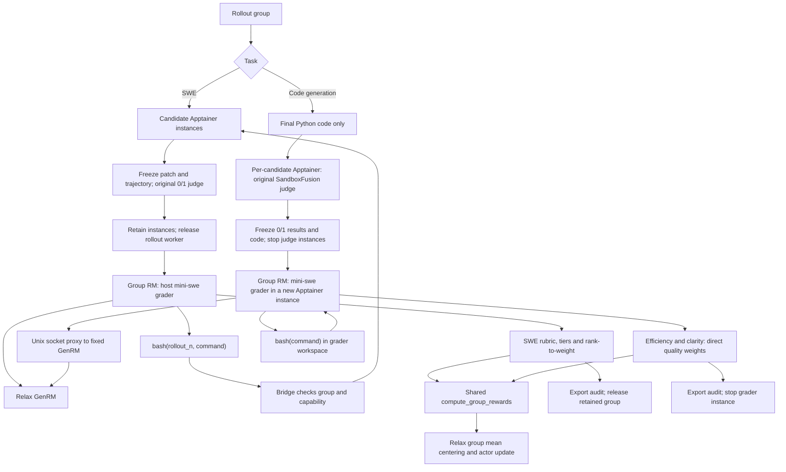

# Agentic grader — Draft demo

The integration is contained in `examples/gagar`. Each task owns its environment,
prompts, scoring adapter and launch scripts. Only the arithmetic, reward record
format and mini-swe grader loop are shared. No core GenRM or other recipe changes
are required.

| Task            | Entry point                                              | Model commands                            | System / instance prompts                                                      |
| --------------- | -------------------------------------------------------- | ----------------------------------------- | ------------------------------------------------------------------------------ |
| Code generation | [code_generate/run_gagar.sh](code_generate/run_gagar.sh) | `bash(command)` in the grader sandbox     | [system](code_generate/grader.yaml) / [instance](code_generate/instance.jinja) |
| SWE             | [minisweagent/run_gagar.sh](minisweagent/run_gagar.sh)   | `bash(rollout_n, command)` via the bridge | [system](minisweagent/grader.yaml) / [instance](minisweagent/instance.jinja)   |

Code generation also includes its [0/1 baseline](code_generate/BASELINE.md).
The SWE directory contains the GAGAR version only, including its own server and
on-demand SIF cache. It preserves original train/eval judging and lifecycle safeguards.

Setup and launch details: [code generation](code_generate/README.md) ·
[SWE](minisweagent/README.md).

## Execution flow

Only task-specific environment adapters execute commands. Both graders reuse the group RM and agent loop, then feed aligned quality weights into the same arithmetic. Their scoring rubrics are intentionally different.

## Recorded execution

Historical SWE and code-generation animations and review notes are kept in
[PR #446](https://github.com/redai-studio/Relax/pull/446). They replay recorded runs,
not a live terminal or a rerun of this branch.

## Shared model messages

`grader_common.py` sends complete `role/content` histories to the existing GenRM
endpoint. When thinking is enabled, the assistant content contains its reasoning
inside `<think>...</think>`, followed by the tool action. The parser executes only
the final action. The code-generation Qwen configuration sets
`preserve_thinking=false` to prevent a second template-generated wrapper.
Malformed/incomplete output still follows format feedback and the existing budget;
there is no constrained JSON decoding.

The replay demonstrates execution and scoring evidence, not a convergence advantage.
