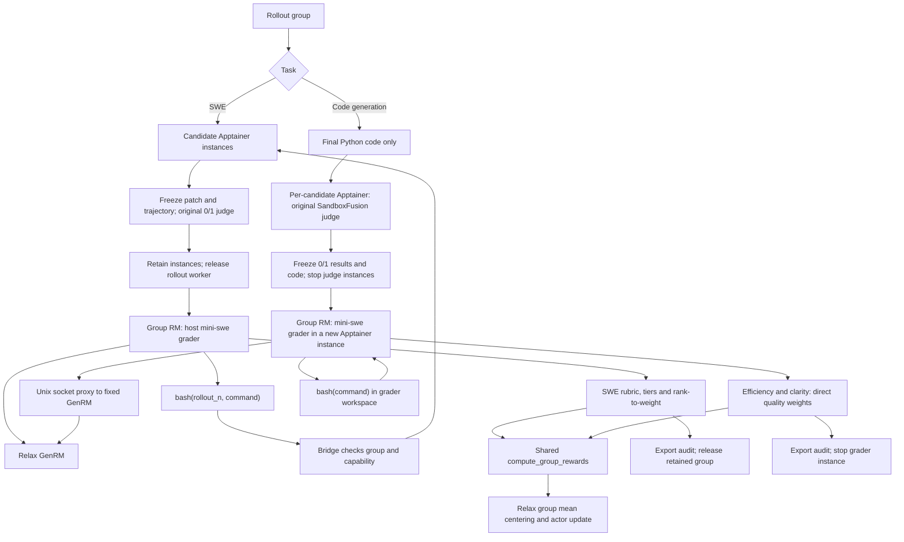

# Agentic grader — Draft demo

> Review/demo only. This integration depends on the binary baseline in [#444](https://github.com/redai-studio/Relax/pull/444) and the standalone arithmetic in [#445](https://github.com/redai-studio/Relax/pull/445). The model rubric is still being evaluated; successful execution is not evidence of faster training convergence.

## Execution flow

Only task-specific environment adapters execute commands. Both graders reuse the group RM and agent loop, then feed aligned quality weights into the same arithmetic. Their scoring rubrics are intentionally different.

## Recorded execution

[Replay notes and complete group results](demo/README.md) accompany two animations. They are curated, time-compressed replays of recorded runs, not a live terminal or a rerun of this branch. Environment setup is documented below and in the code-generation recipe.

This recipe keeps mini-swe-agent's original binary outcome verification and
uses Relax's `--group-rm` to request a group grader. The grader's weights feed
`compute_group_rewards`; Relax performs the final group mean subtraction.

Follow `examples/mini_swe_agent/README.md` for the existing environment, data,
SIF, model, ClearML and launch setup. Launch `run_gagar.sh` with the same
variables. It uses split colocate resources: actor 8 GPUs, rollout 4 GPUs and
GenRM 4 GPUs (TP 4), with `GAGAR_MODEL_PATH` defaulting to
`${MODEL_DIR}/Qwen3.8-27B`. The SWE grader uses a 65,536-token context with
a 2,048-token reply budget per call. No deferred reward hook or custom
advantage is used.
The original recipe remains unchanged when `ENABLE_GAGAR` is unset.

## Two grader environments

| Task            | Command execution                                                                        | System prompt                                          | Instance prompt                                              |
| --------------- | ---------------------------------------------------------------------------------------- | ------------------------------------------------------ | ------------------------------------------------------------ |
| SWE             | `bash(rollout_n, command)` through the bridge to the selected retained candidate sandbox | [grader.yaml](grader.yaml)                             | [instance.jinja](instance.jinja)                             |
| Code generation | `bash(command)` inside the grader's own sandbox                                          | [code_generate/grader.yaml](code_generate/grader.yaml) | [code_generate/instance.jinja](code_generate/instance.jinja) |

Each task loads its own prompts. The system prompt defines its rubric and tools;
the instance prompt provides the task, candidate IDs, original outcomes and
evidence access. SWE uses the paper's rubric and rank-to-weight mapping; code
generation assesses efficiency and clarity and returns quality weights directly.
Both reuse `group_rm`, the common grader loop and `compute_group_rewards`.
Original 0/1 outcomes remain the comparison metric; the equivalent group rewards
are used for training. See the [code-generation recipe](code_generate/README.md).

`run_gagar.sh` enables mini-swe-agent's on-demand SIF cache by default (128 GiB,
two concurrent builds). Prepare only data and wheels with
`R2E_SETUP_SKIP_SIFS=1 bash examples/mini_swe_agent/setup_r2e_data_and_sifs.sh`;
the first use of an image builds it into `R2E_SIF_DIR`. See the mini-swe-agent
README for cache, scratch and proxy settings. `AGENT_SERVER_SIF_CACHE=0` keeps
the prebuilt mode. The SIF lease follows the retained sandbox through outcome
verification and group grading; it is released only after the instance stops.
The cache budget excludes build scratch and cannot evict images still in use.

## Grader process boundary

`GAGAR_GRADER_COMMAND` is a trusted process command, launched in a separate
process by the agent server. It receives `--input <manifest.json>` and
`--output <result.json>`. The manifest contains the task, ordered candidates,
original outcomes, frozen pre-test patch/trajectory, original test output,
Relax GenRM service URL and a short-lived bridge capability. The result is
`{"weights": [...], "rewards": [...]}` in the same candidate order. `rewards`
is optional; corrections may change a pass to a failure, never vice versa.
SWE patches are relative to the tracked working tree after setup and before
actor execution. A private Git index freezes this baseline without changing
HEAD or the real index. This excludes pre-existing dirty image changes while
retaining actor edits, including changes to the same files. The manifest keeps
`baseline` (HEAD, tree and initial diff) and `head_patch` for audit. As in the
original harness, untracked files enter the patch only after they are staged.
Evidence capture failure still runs the original binary judge; incomplete
evidence for any passing candidate makes the group fall back to its outcomes.

The default command runs `examples.gagar.grader` using the mini-swe-agent
virtualenv. Its `DefaultAgent` loop calls the existing Relax GenRM `/generate`
API with complete message history. GenRM currently returns text rather than
native `tool_calls`; the recipe parses one JSON tool action per response,
without changing the framework API. `GAGAR_CONFIG` can select another grader
YAML configuration. The default budget is 40 calls and 1500 seconds.

Only `bash(rollout_n, command)` can execute model-generated commands. The
bridge resolves `rollout_n` within the current immutable group and invokes
the retained environment; it never runs those commands on the host. Missing
or invalid candidate IDs, unknown arguments and expired capabilities are
rejected. Candidate IDs are zero-based and do not encode server endpoints.
The capability is omitted from saved grader evidence after the job ends.

## Lifetime and failures

Completed training sessions transfer their sandbox to the bridge while
immediately releasing the rollout worker. Eval, infrastructure failures and
cancelled sessions keep the original cleanup path. Both passing and failing
completed candidates can be inspected. The grader cannot promote an
unsubmitted trajectory to a passing outcome.

Grading completion, failure and cancellation release the entire group.
Independent lease expiry also covers groups discarded before group RM.
Cleanup waits for an in-flight tool command and keeps failed cleanup entries
for retry; scratch is removed only after the instance stops. Repeated GETs
and release calls are safe. Original server record TTL and retained sandbox
ownership are separate.

| Environment setting         | Default | Meaning                                 |
| --------------------------- | ------- | --------------------------------------- |
| `GAGAR_CONCURRENCY`         | 4       | Concurrent grader processes             |
| `GAGAR_TIMEOUT_SECONDS`     | 1800    | Group grading budget including queueing |
| `GAGAR_RETENTION_SECONDS`   | 14400   | Maximum wait for an unclaimed group     |
| `GAGAR_MAX_RETAINED_GROUPS` | 32      | Group retention budget                  |

Retention pressure never blocks a rollout worker: a group without available
sandboxes falls back to its original outcomes. Size the retention budget and
lease duration for the configured partial-rollout / pause window. A lease
expiry loses grading for that group, not its original outcome reward.

Unavailable or malformed grading falls back for the whole group. Returned
reward fields are `score` (training), `test_reward` (original binary outcome),
`outcome_reward` (after correction), `quality_weight`, and `grader_fallback`.
Eval uses `test_reward`. Equivalent `score` values can exceed one and must not
be clipped or treated as test-pass indicators. Keep mean centering enabled
and GRPO standard-deviation normalization disabled.

## Quality grading (paper Appendix A.1)

The grader inspects all candidates together and assesses original passes on
five integer 1–5 criteria: approach (30%), precision (25%), minimality (20%),
side-effect avoidance (15%), and consistency (10%). The program computes the
initial ordering and tiers from the assessment; model output never directly
chooses arbitrary weights.

- T3 takes precedence: unrequested rewrite, test-specific workaround,
  approach=1, or both minimality and side-effect avoidance \<=2.
- T1 requires every criterion >=4, with no severe process issue or unresolved
  regression. Remaining candidates are T2.
- T1's top tied rank receives 1.0; other T1 ranks receive 0.9.
- T2 tied ranks interpolate from 0.85 to 0.4; a single tied rank receives 0.85.
- T3 receives 0.2. Tied rank counts, rather than preceding candidate counts,
  determine weights.

Rank changes require task-specific explanations. Confirmed reliance on leaked
or external solutions requires separate evidence and changes outcome to zero
before ranking and GAGAR statistics. A test-specific workaround alone is a T3
quality issue, not automatic outcome correction. The result preserves the
assessments, derived tiers and final ranking for review.

The `read_evidence` tool reads frozen pre-test patch/trajectory and original
test output in pages; `bash` inspects the current post-test sandbox. The grader
must distinguish original candidate edits from later test or inspection
changes. Reference-patch similarity is not a quality criterion.

No production training launch is part of the unit tests. Tests using fake
sandboxes and mocked GenRM transport run without Apptainer; real sandbox
validation must be explicitly run on the authorized task machine.
