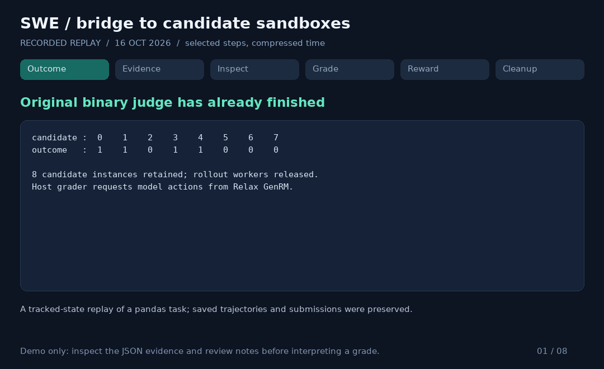
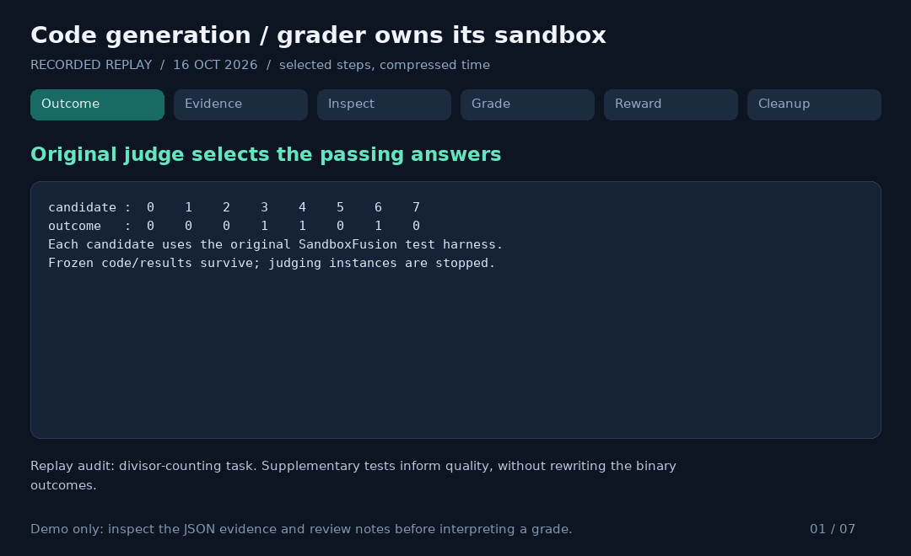

# 真实运行记录回放

这些动画是 **2026-10-16 已保存运行的摘要回放**，选取关键步骤、压缩时间；不是实时终端录像，也没有为制作动画重新启动模型或 sandbox。SWE 包含实际 tool action/result 摘录，代码生成使用已保存实验审计的摘要。JSON 保留整组 outcome、weights、scores、advantages 和评分说明；已去除内部地址、服务凭证与宿主路径。

## SWE：通过 bridge 选择候选环境

[可核对记录](swe-replay.json) 来自 pandas `apply` 任务的 tracked-state 回放：保留原始 trajectory/submission，重建 tracked 修改；历史未跟踪文件和进程状态无法复原。执行时的代码版本是 `7683f55`，早于本分支的目录整理；该 SHA 仅标识当时记录，不表示本分支做了新的 GPU 验证。

关键过程：读取四个通过候选的冻结 patch；初次假定 `/workspace` 失败后用 `pwd` 找到 `/testbed`；按不同 `rollout_n` 执行行为检查；根据五项 rubric、tier 和 ranking 生成权重。整次 grader 有 38 次模型调用、约 84.1 秒，没有 fallback；记录确认八个自有 instance 已停止、scratch 已清理。

| 候选 | 原 outcome | 质量权重 | 训练 reward | 最终优势 |
| ---- | ---------: | -------: | ----------: | -------: |
| 0    |          1 |      1.0 |    1.040541 | 0.540541 |
| 1    |          1 |      0.9 |    0.986486 | 0.486486 |
| 2    |          0 |        0 |           0 |     -0.5 |
| 3    |          1 |      0.9 |    0.986486 | 0.486486 |
| 4    |          1 |      0.9 |    0.986486 | 0.486486 |
| 5    |          0 |        0 |           0 |     -0.5 |
| 6    |          0 |        0 |           0 |     -0.5 |
| 7    |          0 |        0 |           0 |     -0.5 |

需要 review 的部分：模型重复运行了多次相似的 pytest/grep，最终由预算提醒推动提交。记录显示缺失 fixture，但模型声称全部属于既有问题，不能仅凭这次回放独立证实。模型偏好命名布尔变量、下调等价内联条件的细微排序，也不是功能优越性的证据。

## 代码生成：独立 grader sandbox

[可核对记录](codegen-replay.json) 来自 divisor-counting 题目的 focused-feedback 回放。原始 outcome 选出候选 3、4、6；grader 在自己的环境中比较筛法与逐元素试除法，保存了 72 个暴力校验小样例以及相同输入的耗时观测。

| 压力输入类型  | 候选 3 / 秒 | 候选 4 / 秒 | 候选 6 / 秒 |
| ------------- | ----------: | ----------: | ----------: |
| high distinct |        0.10 |        0.09 |        7.60 |
| low distinct  |        0.15 |        0.59 |        0.11 |
| mixed         |        0.43 |        0.56 |        0.11 |

每种压力输入在这次记录中仅计时一次，不能把精确比值当作稳定加速比。原始 0/1 判题结果保持不变；补充实验只影响质量权重。

| 候选 | 原 outcome | 质量权重 | 训练 reward | 最终优势 |
| ---- | ---------: | -------: | ----------: | -------: |
| 0    |          0 |        0 |           0 |   -0.375 |
| 1    |          0 |        0 |           0 |   -0.375 |
| 2    |          0 |        0 |           0 |   -0.375 |
| 3    |          1 |     0.95 |    1.166667 | 0.791667 |
| 4    |          1 |     0.85 |    1.083333 | 0.708333 |
| 5    |          0 |        0 |           0 |   -0.375 |
| 6    |          1 |     0.45 |        0.75 |    0.375 |
| 7    |          0 |        0 |           0 |   -0.375 |

这次运行有 17 次模型调用、6 次格式错误后恢复、无 fallback，清理已确认。它早于后续 tool 格式兼容和 prompt 文件拆分，不使用 JSON 约束解码。对高 distinct 输入的显著试除开销有观测支持；两个筛法分别 0.95/0.85 的细微分差仍可争议。模型关于“最优”和原测试为何通过的断言没有由这些记录证明。

## 如何读这些材料

- [总流程、SWE 环境与生命周期](../DEMO.md)；[代码生成镜像构建和启动](../code_generate/README.md)。环境准备图是当前实现说明，动画是历史观测，二者不要混同为本分支新跑的端到端结果。
- [SWE system prompt](../grader.yaml) / [instance prompt](../instance.jinja)；[代码生成 system prompt](../code_generate/grader.yaml) / [instance prompt](../code_generate/instance.jinja)。system 定义工具和标准，instance 只放具体 task、候选 outcome 和证据入口。
- 比较 baseline 时使用原始 0/1 outcome。以上展示链路行为和评分依据，不宣称训练收敛更快。
